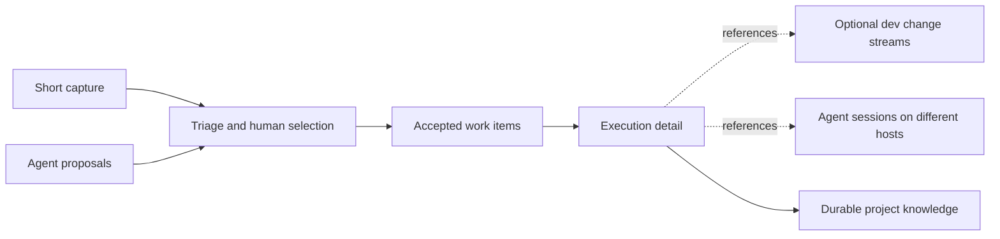

# Human and agent work items

Keep a small, understandable set of accepted outcomes in front of the human,
while agents maintain the execution detail behind them. Persistent work items
can support that arrangement; replacing the tracker alone cannot make an
unattended backlog useful.

!!! info "Research boundary"
    This is a project recommendation informed by source review on **2026-10-29**.
    Upstream revisions are listed below; they are not the versions tested on the
    user's machines. The workflow trial has not run. This change adds guidance,
    not a dev work-item backend, synchronization service or task deprecation.

## What prompted the review

The maintainer reported that dev tasks are rarely used and that experiments
with td and Sidecar have not led to regularly reading their task views. Moving
work into a database or an issue tracker therefore has not, by itself, improved
participation. This is qualitative feedback, not a measured comparison or the
result of the isolated worktree lifecycle trial.

The target is one person collaborating with several agents, sometimes on
different devboxes through Herdr remote. Capture should work with one short
line. An item should remain referenceable across repositories and sessions,
without requiring GitHub, Linear or even a repository at capture time.

Existing project practices already solve part of this problem:

- [project-knowledge-harness][pkh] separates deferred intent in TODO, research
  and pitfalls in Markdown, and optional td execution records. Its inbox allows
  unstructured capture. The bridge currently matches TODO and td by exact title;
  that is a portability compromise, not a general identity scheme.
- [forge-native-dev][forge-native] uses hosted issues for actionable work and
  PRs for review. Its one-issue/one-PR/one-commit convention is useful for a
  bounded patch, but cannot define every long-lived outcome. The agent-skills
  repository [moved its own backlog to Issues and Discussions][skills-todo] on
  2026-10-27; its TODO is now a pointer, not the active backlog.

Both approaches need a clearer distinction between a recorded suggestion and
a commitment. They also need a place the human actually revisits. Our proposed
rule is **one authoritative home per fact**, with explicit references between
layers; it does not require one tool for every layer. These are recommendations
for evaluation, not changes to either skill's current contract.

## Work items, change streams and sessions

| Concept | What it records | Example |
|---|---|---|
| Capture | A thought worth keeping, with its original wording and source | “Look into slow login later” |
| Proposal | A possible new outcome, not yet accepted | An agent suggests replacing the session cache |
| Accepted work item | A desired outcome and a way to judge completion | Fix login timeouts under the reproduced condition |
| Execution detail | Steps, evidence, dependencies and handoff context | Reproduce, test, implement, review |
| dev task / change stream | Checkout mode, branch/base, lifecycle intent and next action | Continue the fix branch tomorrow |
| Agent session | One conversation or execution context | Investigation on devbox A, implementation on B |
| Project knowledge | Findings useful beyond this item | Why the old cache invalidation failed |

These are workflow concepts, not new persisted dev states. References need not
be one-to-one: a work item may need several branches or PRs, and one change
stream may address several related items. A session may touch several items;
an item may outlive all its sessions. Research can finish without a branch,
and task-free work remains legitimate.

In the [current dev task model][dev-task], the ID is derived from repository
and branch. `Owner` identifies a host, not a human assignee. `AgentSession` is
reserved but not captured or attached by production start/park/resume;
runtime handles are advisory. Retirement removes the task record. Those are
poor foundations for a permanent issue identity, even though they serve
checkout lifecycle management. See the [mental model](../concepts/mental-model.md).

## What the tools contribute

The following is a capability comparison, not an adoption ranking.

| Approach | Human participation and agent work | Across repositories and machines | Main tradeoff |
|---|---|---|---|
| Markdown inbox / TODO | Direct editing and agent-readable intent; long analysis can be linked | Git can carry committed text; global discovery and stable item references need a convention or index | Very low capture cost, but files do not create a review habit or concurrent work claims |
| [GitHub Issues / Projects][github-projects] | Shared issues, discussion and configurable project views | Projects can collect items from multiple repositories; hosted issue identity is shared | Requires service access; creating issues freely can still overwhelm the human |
| [Linear][linear-triage] | Triage precedes acceptance; [human assignment and agent delegation][linear-assignment] are distinct | Shared workspace supplies the coordination surface | Useful interaction model, but not a required dependency for a local dev tool |
| [td][td] + [Sidecar Tasks][sidecar-tasks] | td retains logs, handoffs and review across sessions; Sidecar separates personal Inbox / Next / Agenda / Projects from TD, with explicit promotion | Personal planning spans repos; td has optional server sync, with local session identity | Another interface only helps when it is part of the daily loop; sync needs deliberate setup |
| [Beads][beads] / [Dolt][dolt] | Persistent dependency graph and ready work; simple TODO capture and a focused human-intervention queue | Work can retain identity across sessions; Dolt supplies versioned data and remote synchronization | A graph helps agents find work, but does not decide which suggestions deserve human attention |
| [Herdr UI][herdr-orchestrator] | Brings issue dispatch, runs and review into the working environment; Overview highlights agents needing attention | Orchestrator lists GitHub, GitLab and Beads sources across connected hosts' workspaces | It is a useful projection and execution surface, with discovery and freshness limits |

Several version details matter when interpreting this table:

- Current Beads uses **Dolt**, with an embedded single-writer mode and an
  external server option for concurrent writers. JSONL is interchange, not the
  authoritative store or a full database backup. Dolt's version history and
  synchronization solve data concerns; human prioritization remains a workflow
  concern. See [storage][beads] and [sync concepts][beads-sync].
- [`bd todo`][beads-todo] creates ordinary issues in the same store. Its
  [`human` commands][beads-human] offer a focused intervention queue; responding
  closes that request, which should not be confused with accepting all related
  product work. Sidecar's separate personal Tasks and explicit promotion to TD
  demonstrate a different valid design.
- td [sync is optional][td-sync], currently behind `sync_cli`. Do not infer
  “local-only” from an older description, or universal independent-session
  approval from an older review rule: current [review policy][td] includes
  trusted, delegated and strict choices. Replication alone is not a global
  claim or mutual-exclusion guarantee.
- Herdr's observed Orchestrator scope is repositories represented by connected
  workspaces, with up to 32 repositories listed. It retains prior results with
  an error when a host is unreachable. This is not discovery of every dormant
  repo on every machine. Its [Beads adapter][herdr-beads] reads `bd` JSON through
  the main checkout, rather than an old JSONL file. The installed Herdr/Beads
  pair, routing and read-side effects still need a real compatibility trial.

## A collaboration loop with little ceremony

This is the recommended trial policy. It can be represented by sections,
labels or views; it does not prescribe a database schema.

1. **Capture without classification.** Keep the person's original sentence and
   return where it was saved. Repository, priority and effort may be unknown.
   A chat acknowledgement is not persistence. For repository thoughts,
   `dev repo note add "Investigate slow login" --repo api` already stores a
   durable note, but notes have no built-in promotion or work-item queue.
   A configured Markdown inbox can also be enough.
2. **Separate proposals from accepted work.** Agents can group duplicates,
   supply context and suggest an outcome. New directions go to proposals, with
   their source and related item. They do not silently become commitments.
   Let the human accept, combine, defer or reject a group in one interaction.
3. **Expand accepted work autonomously.** Reproduction, implementation and tests
   can be internal steps under the outcome. Do not interrupt the human for
   each step. Promote a step to its own item when it needs independent ownership,
   a separately accepted outcome or a durable cross-session dependency.
4. **Present decisions before inventory.** Start the human view with questions
   or reviews waiting on them, then accepted work in progress, then a small
   selection of proposed next work. Each question includes context, options,
   the consequence of waiting and a link to evidence. Show proposal totals and
   allow expansion; hiding detail must not make it undiscoverable.
5. **Close the loop.** Record the decision or completion evidence in the item's
   authoritative home, then update its projections. Completion follows the
   acceptance criteria and agreed authority, not merely an agent's “done”
   signal. Harvest reusable findings into knowledge without copying the whole
   activity log into the human backlog.

For example, “Look into slow login” first stays in the inbox. After selection,
it becomes an investigation with a decision to make. An agent on devbox A
reproduces the timeout and proposes a bounded fix plus a larger cache redesign.
The human accepts the fix as the next outcome, explicitly updates the same
item's acceptance criteria, and defers the redesign. An agent on B implements
and tests the fix; a later session reviews it. The item's identity and those
agreed criteria stay the same across these sessions while execution references accumulate.
Neither the deferred redesign nor every test becomes another top-level promise.

Begin the trial with a short summary when starting work or receiving a handoff.
A suggested attention budget is three to five decisions or outcomes at once,
with the remaining count visible. This is an adjustable trial default, not a
limit on stored work. A later scheduled digest can reuse the same view, grouping
repeats and respecting deferral. Scheduling a digest is separate from authorizing
agents to claim work, launch sessions or change repositories.

## Identity and synchronization across devboxes

A stable reference must include the source's scope as well as its item ID.
For example, an issue number needs its forge/repository, and a local tracker ID
needs its database/project namespace. Keep host, checkout and session references
as execution context. Similar titles, remote paths or branch names are not
evidence that two items are the same. A cross-repo outcome can reference several
repository-specific changes without being duplicated into several master lists.

One authoritative home does not require one central server. There are two
distinct arrangements to evaluate:

| Arrangement | What must be explicit |
|---|---|
| One store reached remotely | Which host/service owns it, how references resolve, and what remains available when it is offline |
| Replicated stores | Shared project identity, sync transport, conflict handling, freshness, backup and the boundary of atomic claims |

An offline snapshot must retain its source and last observation time. Unknown
does not mean empty, complete or safe to claim. Offline capture may remain
pending synchronization; concurrent acceptance-criteria edits and completion
reports must not silently erase the human's decision. A tracker whose merge
policy cannot preserve that distinction needs a restricted writer arrangement
or another workflow before the trial can rely on it.

dev does not synchronize notes or catalog files itself. Its current [fleet
snapshot][dev-fleet] carries per-repository task counts, not a shared work-item
or human decision queue. Remote navigation therefore does not establish shared
backlog authority. Copying task TOML or runtime databases between machines is
not a substitute for that design.

## What should change in dev?

**For now, clarify the boundary and test the workflow.** A permanent work-item
store is conceptually close to Beads. dev's useful contribution remains
repository discovery, checkout/runtime preparation and guarded lifecycle
operations. That is a reason to examine integration, not to replace taskflow.

The [existing worktree trial][dev-trial] remains separate. This research keeps
task-free work available and managed tasks useful when park/resume and recorded
next actions help. Issue closure cannot authorize cleanup; taskflow still
revalidates Git, runtime, artifacts and ownership. Closing a session or safely
retiring a checkout must not erase the work item's history.

| Stage | Work to do | Evidence needed before the next stage |
|---|---|---|
| Document now | Agree vocabulary, proposal policy, source boundaries and scenarios | Human and agent can distinguish a suggestion, a commitment and an execution step |
| Try existing surfaces | In two selected repos and two devboxes, try the native Herdr view or an existing inbox plus an explicit summary recipe | Capture is recoverable, decisions are actually revisited, and handoffs retain the same item identity |
| Add the smallest missing capability | Evaluate a capture helper, explicit work-item references, or a bounded aggregation view according to the observed gap | The failure cannot be addressed adequately by the chosen tracker, its native UI or a small workflow adjustment |

Before a real trial, record the installed versions, selected source of truth,
read/sync side effects, host/repo coverage and how to retain/export the trial's
work. Do not invoke trackers from ordinary dev refresh merely because their
commands look like reads; reads may initialize, migrate or synchronize state.
No installation, migration or scheduled job is part of this documentation change.

If code is later warranted, preserve the tracker's identity rather than mirror
its backlog into dev tasks. Any new Task TOML fields need a separate versioning
and downgrade design: older binaries can erase unknown fields on rewrite.
There is no new CLI, JSON contract, persistence schema or automatic completion
synchronization in this proposal.

## Trial scenarios and decision record

These are acceptance scenarios, **not passing test results**. Record observations
and the chosen next action alongside the existing trial research.

| Scenario | Expected behavior to verify |
|---|---|
| One-line thought outside a repo | Saved durably without requiring a branch, priority or full issue form; the person can find it again |
| Several agents produce many findings | Proposals remain separate; related findings are grouped and batch decisions are possible without reading every execution step |
| Work within an accepted goal | Agents reproduce, implement and test without requesting approval for every internal step |
| Research on A, implementation on B, later review | The same work item retains its criteria, evidence and resolvable execution references |
| Two similarly named repositories or independent stores | Items are not merged by title, branch, path or unscoped ID |
| Host unavailable or concurrent edits | Staleness/pending sync is visible; no false completion, lost decision or unsupported global claim |
| Runtime changes or checkout retirement | The work item survives; cleanup follows its own fresh checks |
| Returning to work after a gap | The human can identify what needs a decision and act without reconstructing every agent conversation |

For each trial session, note capture friction, where the human actually read
and answered, duplicate entry, missing context and manual reconciliation. Mark
unvisited views and untested scenarios honestly. A tracker producing more items
or agents completing more steps is not evidence of better human participation.

## Sources and revision boundaries

- dev-cli: source snapshot `531f2661307c366b23f9421ba369a5bc21b7d6f5`;
  [task model][dev-task], [fleet projection][dev-fleet], [prior trial][dev-trial].
- agent-skills: inspected local source snapshot
  `7f295df170245f1d5512fc02c4f8dd90604e9472`; [PKH tracker rules][pkh],
  [forge conventions][forge-native], [backlog migration][skills-todo].
- td `359fd41c17729cff3e5c23ba5478b44cc162096f`: [README/review policy][td]
  and [sync setup][td-sync].
- Sidecar `2a2978a8a3e56f61d10f27edf4e17e4cc4a5d8b0`: [personal Tasks][sidecar-tasks].
- Beads `e226083653b893998614df4225f73b6688ca9166`: [README/storage][beads];
  living docs for [TODO][beads-todo], [human intervention][beads-human] and
  [synchronization][beads-sync], reviewed on the date above.
- Dolt `9138543aa63438ef1124731a92424366302c9641`: [versioned database overview][dolt].
- Herdr UI `a5b2df2db54061cd2785c3ddf184bce348be3fd1`:
  [Orchestrator][herdr-orchestrator] and [Beads CLI adapter][herdr-beads].
- Living service documentation: [GitHub Projects][github-projects],
  [Linear Triage][linear-triage] and [assignment/delegation][linear-assignment].

## Related pages

- [Mental model and lifecycle](../concepts/mental-model.md)
- [Worktrees and provisioning](../guides/worktrees-provisioning.md)
- [Repository quick notes](../guides/tui-repos-bootstrap.md)
- [Remote repository fleet](../guides/remote-fleet.md)
- [Sources and freshness](../reference/sources-freshness.md)

[dev-task]: https://github.com/daviddwlee84/dev-cli/blob/531f2661307c366b23f9421ba369a5bc21b7d6f5/internal/task/task.go
[dev-fleet]: https://github.com/daviddwlee84/dev-cli/blob/531f2661307c366b23f9421ba369a5bc21b7d6f5/internal/fleet/types.go
[dev-trial]: https://github.com/daviddwlee84/dev-cli/blob/531f2661307c366b23f9421ba369a5bc21b7d6f5/backlog/project-navigation-and-task-trial.md
[pkh]: https://github.com/daviddwlee84/agent-skills/blob/7f295df170245f1d5512fc02c4f8dd90604e9472/skills/local/project-knowledge-harness/references/integrating-trackers.md
[forge-native]: https://github.com/daviddwlee84/agent-skills/blob/7f295df170245f1d5512fc02c4f8dd90604e9472/skills/local/forge-native-dev/SKILL.md
[skills-todo]: https://github.com/daviddwlee84/agent-skills/blob/7f295df170245f1d5512fc02c4f8dd90604e9472/TODO.md
[github-projects]: https://docs.github.com/en/issues/planning-and-tracking-with-projects/learning-about-projects/about-projects
[linear-triage]: https://linear.app/docs/triage
[linear-assignment]: https://linear.app/docs/assigning-issues
[td]: https://github.com/marcus/td/blob/359fd41c17729cff3e5c23ba5478b44cc162096f/README.md
[td-sync]: https://github.com/marcus/td/blob/359fd41c17729cff3e5c23ba5478b44cc162096f/docs/guides/sync-setup-guide.md
[sidecar-tasks]: https://github.com/marcus/sidecar/blob/2a2978a8a3e56f61d10f27edf4e17e4cc4a5d8b0/website/docs/tasks.md
[beads]: https://github.com/gastownhall/beads/blob/e226083653b893998614df4225f73b6688ca9166/README.md
[beads-todo]: https://beads.gascity.com/workflows/todo
[beads-human]: https://beads.gascity.com/cli-reference/human
[beads-sync]: https://beads.gascity.com/core-concepts/sync-concepts
[dolt]: https://github.com/dolthub/dolt/blob/9138543aa63438ef1124731a92424366302c9641/README.md
[herdr-orchestrator]: https://github.com/penso/herdr-gpui/blob/a5b2df2db54061cd2785c3ddf184bce348be3fd1/crates/herdr-gpui/README.md#orchestrator
[herdr-beads]: https://github.com/penso/herdr-gpui/blob/a5b2df2db54061cd2785c3ddf184bce348be3fd1/crates/herdr-orchestrator/src/beads.rs
