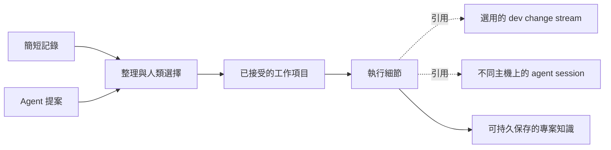

# 人與 agent 的工作項目

讓人面前維持少量、容易理解且已接受的工作成果，由 agent 維護背後的執行細節。
可持久保存的工作項目（work item）能支援這種分工；但光是換一個追蹤工具，
無法讓沒有人回看的待辦清單變得有用。

!!! info "研究範圍"
    本文是根據 **2026-10-29** 來源查閱提出的專案建議。
    下方列出的上游 revision 並非已在使用者機器上測試的版本。
    工作流程試用尚未進行。這次變更新增的是指引，沒有新增 dev 工作項目後端、
    同步服務，也沒有棄用 task 功能。

## 為什麼重新檢視

維護者回饋，dev tasks 很少使用；在部分專案試用 td 與 Sidecar 後，
也沒有養成定期查看其任務畫面的習慣。因此，光是把工作移到資料庫或 issue tracker，
並未改善人的參與。這是使用感受的回饋，不是量化比較，也不是隔離環境中
worktree 生命週期試用的結果。

目標是一個人與多個 agent 協作，有時透過 Herdr remote 在不同 devbox 上工作。
記錄想法應該只需要簡短一句話。工作項目應能跨 repository 與 session 持續被引用，
而不必在記錄當下就依賴 GitHub、Linear，甚至不必先有 repository。

現有專案慣例已解決部分問題：

- [project-knowledge-harness][pkh] 把暫緩的意圖放在 TODO，研究與踩坑經驗放在 Markdown，
  並可選用 td 保存執行記錄。它的 inbox 允許尚未整理的簡短記錄。
  目前 bridge 以完全相同的標題對應 TODO 與 td；這是可攜性上的折衷，
  不是通用的身分識別方案。
- [forge-native-dev][forge-native] 用託管平台上的 issue 記錄可執行的工作，以 PR 進行審查。
  一個 issue／一個 PR／一個 commit 的慣例適合範圍明確的修改，
  卻無法定義所有長期目標。agent-skills repository 已於 2026-10-27
  [把自身待辦移到 Issues 與 Discussions][skills-todo]；它的 TODO 現在只是入口，
  不再是持續維護的待辦清單。

兩種方式都需要更清楚地區分「記下的建議」與「承諾要做的事」，
也都需要一個人實際會回看的地方。我們建議的規則是：**每項事實只有一個權威來源**，
各層以明確引用連接；不要求所有層都使用同一工具。
這些是待評估的建議，尚未改變兩個 skill 目前的契約。

## 工作項目、change stream 與 session

| 概念 | 記錄什麼 | 範例 |
|---|---|---|
| 隨手記錄 | 值得保留的想法，以及原始措辭與來源 | 「之後查一下登入為什麼很慢」 |
| 提案 | 尚未接受的可能成果 | Agent 建議替換 session cache |
| 已接受的工作項目 | 希望達成的成果，以及判斷完成的方法 | 修正在已重現條件下的登入逾時 |
| 執行細節 | 步驟、證據、相依關係與交接脈絡 | 重現、測試、實作、審查 |
| dev task / change stream | Checkout 模式、branch/base、生命週期意圖與下一步 | 明天繼續處理修正用的 branch |
| Agent session | 一次對話或執行脈絡 | 在 devbox A 調查、在 B 實作 |
| 專案知識 | 超越此工作項目仍有用的發現 | 舊的 cache 失效機制為何出錯 |

這些是工作流程概念，不是 dev 新增的持久化狀態。引用關係不必是一對一：
一個工作項目可能需要數個 branch 或 PR；一個 change stream 也可能處理數個相關項目。
一個 session 可以涉及多個項目；工作項目則可以比所有相關 session 存續更久。
研究可以在沒有 branch 的情況下完成，不使用 task 的工作方式也依然成立。

在[目前的 dev task 模型][dev-task]中，ID 由 repository 與 branch 衍生。
`Owner` 表示主機，不是被指派的人。`AgentSession` 是保留欄位，
正式的 start/park/resume 流程並未擷取或綁定它；runtime handle 也只是參考提示。
Retirement 會移除 task 記錄。這些設計能支援 checkout 生命週期管理，
卻不適合作為永久 issue 身分的基礎。另見[心智模型](../concepts/mental-model.md)。

## 各工具提供什麼

以下比較能力，不是推薦採用的排名。

| 方式 | 人類參與與 agent 工作 | 跨 repository 與機器 | 主要取捨 |
|---|---|---|---|
| Markdown inbox / TODO | 可直接編輯，agent 也能讀取意圖；長篇分析可另外連結 | Git 可攜帶已 commit 的文字；全域查找與穩定的項目引用需要慣例或索引 | 記錄成本很低，但檔案本身不會建立回看習慣，也不提供並行工作的認領機制 |
| [GitHub Issues / Projects][github-projects] | 共用 issue、討論與可設定的專案視圖 | Projects 可彙集多個 repository 的項目；平台上的 issue 身分可共用 | 需要存取服務；任意新增 issue 仍可能淹沒人的注意力 |
| [Linear][linear-triage] | 先整理再接受；[指派給人與委派給 agent][linear-assignment] 是不同動作 | 共用 workspace 提供協作介面 | 互動模型值得參考，但不必成為本地 dev 工具的必要依賴 |
| [td][td] + [Sidecar Tasks][sidecar-tasks] | td 跨 session 保存記錄、交接與審查；Sidecar 把個人的 Inbox / Next / Agenda / Projects 與 TD 分開，透過明確操作提升為 TD 工作 | 個人規劃可跨 repository；td 可選用伺服器同步，session 身分仍在本地 | 多一個介面只有融入日常流程才有幫助；同步需要明確設定 |
| [Beads][beads] / [Dolt][dolt] | 持久化相依圖與可開始的工作；簡單 TODO 記錄與集中的人類介入佇列 | 工作可以跨 session 保留身分；Dolt 提供資料版本與遠端同步 | 圖結構幫助 agent 找到工作，但不會決定哪些建議值得人注意 |
| [Herdr UI][herdr-orchestrator] | 把 issue 分派、執行與審查帶進工作環境；Overview 凸顯需要注意的 agent | Orchestrator 列出已連線主機 workspace 中的 GitHub、GitLab 與 Beads 來源 | 適合呈現彙整資訊與執行工作，但有發現範圍與資料新鮮度的限制 |

解讀上表時，有幾個版本細節需要留意：

- 目前 Beads 使用 **Dolt**，提供嵌入式單一寫入者模式，以及支援並行寫入者的外部伺服器選項。
  JSONL 用於資料交換，不是權威儲存來源，也不是完整的資料庫備份。
  Dolt 的版本歷史與同步處理的是資料問題；人如何決定優先順序仍是工作流程問題。
  參閱[儲存方式][beads]與[同步概念][beads-sync]。
- [`bd todo`][beads-todo] 會在同一資料庫中建立一般 issue。
  它的 [`human` 指令][beads-human] 提供集中的介入請求佇列；
  回應會關閉該請求，不應把它理解成已接受所有相關產品工作。
  Sidecar 把個人 Tasks 分開，並明確提升為 TD 工作，示範了另一種成立的設計。
- td 的[同步是選用功能][td-sync]，目前由 `sync_cli` 開關控制。
  不要根據舊說明推論它「只能在本地使用」，也不要從舊審查規則推論所有情況
  都必須由獨立 session 核准：目前的[審查政策][td]包含 trusted、delegated 與 strict 選項。
  資料複寫本身不保證全域認領或互斥。
- 本次查閱的 Herdr Orchestrator 範圍是已連線 workspace 所代表的 repository，
  最多列出 32 個 repository。主機無法連線時，它保留先前結果並顯示錯誤。
  這不等於能找出每台機器上所有未使用中的 repository。
  它的 [Beads adapter][herdr-beads] 透過主 checkout 讀取 `bd` JSON，而非舊的 JSONL 檔案。
  實際安裝的 Herdr／Beads 組合、路由與讀取副作用仍需要真正的相容性試用。

## 少一點儀式的協作循環

以下是建議試用的政策。可以用章節、標籤或視圖表達，不限定資料庫 schema。

1. **先記錄，不急著分類。** 保留人的原句，並回報儲存位置。
   Repository、優先順序與預估工作量都可以暫時未知。對話中回一句「記下了」不等於持久保存。
   對於 repository 相關想法，現有的
   `dev repo note add "Investigate slow login" --repo api` 已能保存持久筆記，
   但筆記沒有內建的提升流程或工作項目佇列。設定好的 Markdown inbox 也可能足夠。
2. **把提案與已接受的工作分開。** Agent 可以合併重複內容、補充脈絡並建議成果。
   新方向放進提案，附上來源與相關項目，不默默變成承諾。
   讓人一次互動就能接受、合併、暫緩或拒絕一組提案。
3. **自主展開已接受的工作。** 重現、實作與測試可以是成果之下的內部步驟，
   不要為每一步打斷人。當步驟需要獨立負責人、另行接受的成果，
   或跨 session 持續存在的相依關係時，再提升為獨立項目。
4. **先呈現待決事項，再呈現完整清單。** 人的視圖先顯示等待回覆的問題或審查，
   再顯示進行中的已接受工作，最後提供少量建議的下一步。
   每個問題附上脈絡、選項、等待的影響與證據連結。
   顯示提案總數並允許展開；收起細節不能讓它們變得找不到。
5. **把結果寫回來源。** 在項目的權威來源記錄決定或完成證據，再更新其他呈現方式。
   完成與否依據驗收條件及約定的決定權，而不只是 agent 的「done」訊號。
   把可重用的發現整理成知識，不要把整份活動記錄複製到給人看的待辦清單。

例如，「之後查一下登入為什麼很慢」先留在 inbox。被選中後，
它成為一項需要作出決定的調查。Devbox A 上的 agent 重現逾時，
提出一個範圍明確的修正，以及一個規模較大的 cache 重新設計方案。
人接受修正作為下一個成果，明確更新同一項目的驗收條件，並暫緩重新設計。
B 上的 agent 實作並測試修正，之後再由另一個 session 審查。
執行引用持續累積，但項目的身分與這些已約定的條件在上述 session 之間維持不變。
暫緩的重新設計方案與每項測試，都不會因此變成另一個最上層承諾。

試用初期，在開始工作或收到交接時提供簡短摘要。
建議一次呈現三到五個需要決定的事項或成果，並顯示其餘數量。
這是可調整的試用預設，不限制儲存的工作數量。未來的定時摘要可以沿用同一視圖，
合併重複項目並尊重暫緩決定。設定摘要排程，與授權 agent 認領工作、
啟動 session 或變更 repository 是不同的事。

## 跨 devbox 的身分與同步

穩定的引用必須同時包含來源範圍與項目 ID。例如，issue 編號需要搭配其 forge／repository，
本地追蹤工具的 ID 則需要資料庫／專案命名空間。主機、checkout 與 session 引用
應保留為執行脈絡。相似標題、遠端路徑或 branch 名稱，不能證明兩個項目是同一件事。
跨 repository 的成果可以引用數個 repository 各自的變更，
而不必複製成數份總待辦清單中的主項目。

單一權威來源不等於只能有一台中央伺服器。有兩種不同安排值得評估：

| 安排 | 必須明確定義什麼 |
|---|---|
| 遠端存取同一資料庫 | 哪台主機／服務擁有它、如何解析引用，以及離線時還能使用什麼 |
| 複寫資料庫 | 共用的專案身分、同步傳輸、衝突處理、新鮮度、備份，以及原子認領的適用範圍 |

離線快照必須保留來源與最後觀察時間。未知不代表空白、完成或可安全認領。
離線記錄可以保持待同步；並行修改的驗收條件與完成回報，不能默默抹去人的決定。
如果追蹤工具的合併政策無法保留這項區別，就需要限制寫入者安排或採用另一種流程，
試用才能依賴它。

dev 本身不會同步筆記或 catalog 檔案。它目前的 [fleet 快照][dev-fleet]
攜帶的是每個 repository 的 task 數量，不是共用工作項目或人類決策佇列。
因此，能做遠端導覽並不代表已建立共用待辦的權威來源。
在機器間複製 task TOML 或 runtime 資料庫，也不能取代這項設計。

## dev 應該改什麼？

**目前先釐清分工，再試用工作流程。** 永久的工作項目儲存，在概念上接近 Beads。
dev 有用的貢獻仍是 repository 發現、checkout／runtime 準備，以及有保護機制的生命週期操作。
這值得研究整合方式，不代表要替換 taskflow。

[既有的 worktree 試用][dev-trial]維持獨立。本次研究保留不使用 task 的工作方式；
當 park/resume 與記錄下一步有幫助時，managed task 仍然有用。
Issue 關閉不能授權清理；taskflow 仍會重新驗證 Git、runtime、artifact 與所有權。
關閉 session 或安全退役 checkout，都不應抹去工作項目的歷史。

| 階段 | 要做的工作 | 進入下一階段前需要的證據 |
|---|---|---|
| 現在先寫文件 | 確認術語、提案政策、來源分工與情境 | 人與 agent 能分辨建議、承諾與執行步驟 |
| 試用既有介面 | 在選定的兩個 repository 與兩台 devbox，試用 Herdr 原生視圖，或既有 inbox 搭配明確的摘要操作流程 | 記錄找得回來、人確實會回看待決事項，交接也保留同一項目身分 |
| 補最小的缺口 | 依觀察到的不足，評估快速記錄 helper、明確的工作項目引用，或範圍受限的彙整視圖 | 問題無法由選定的追蹤工具、原生 UI 或小幅流程調整充分解決 |

真正試用前，先記錄安裝版本、選定的權威來源、讀取／同步副作用、主機／repository 涵蓋範圍，
以及如何保留／匯出試用中的工作。不要只因指令看似讀取，就在 dev 一般重新整理時呼叫追蹤工具；
讀取也可能初始化、遷移或同步狀態。本次文件變更不包含安裝、遷移或排程工作。

如果之後確實需要寫程式，應保留追蹤工具的身分，而非把它的待辦鏡像到 dev tasks。
新增 Task TOML 欄位需要獨立的版本與降級設計：舊版 binary 重新寫入時可能抹去未知欄位。
本提案沒有新增 CLI、JSON 契約、持久化 schema 或自動完成同步。

## 試用情境與決策記錄

以下是驗收情境，**不是已通過的測試結果**。請把觀察與選定的下一步
記錄在既有試用研究旁。

| 情境 | 預期驗證的行為 |
|---|---|
| 在 repository 之外記下一句想法 | 不要求 branch、優先順序或完整 issue 表單就能持久保存，而且人能再次找到 |
| 數個 agent 產生大量發現 | 提案維持獨立；相關發現可分組、批次決定，不必讀完每個執行步驟 |
| 在已接受的目標內工作 | Agent 自主重現、實作與測試，不為每個內部步驟要求核准 |
| 在 A 研究、B 實作，之後再審查 | 同一工作項目保留條件、證據，以及可解析的執行引用 |
| 兩個名稱相近的 repository 或獨立資料庫 | 不依標題、branch、路徑或缺少來源範圍的 ID 合併項目 |
| 主機無法使用或發生並行編輯 | 過時／待同步狀態可見；不產生假完成、遺失決定或未受支援的全域認領 |
| Runtime 改變或 checkout 退役 | 工作項目繼續存在；清理依其自身的新鮮檢查進行 |
| 隔一段時間後回來工作 | 人能找出需要決定的事並採取行動，不必重建每段 agent 對話 |

每次試用都記下記錄想法的阻力、人實際在哪裡閱讀與回覆、重複輸入、缺少的脈絡，
以及手動對帳的情況。如實標記未曾查看的視圖與尚未測試的情境。
追蹤工具產生更多項目，或 agent 完成更多步驟，都不代表人的參與改善了。

## 來源與 revision 範圍

- dev-cli：來源快照 `531f2661307c366b23f9421ba369a5bc21b7d6f5`；
  [task 模型][dev-task]、[fleet 呈現資料][dev-fleet]、[先前試用][dev-trial]。
- agent-skills：查閱的本地來源快照
  `7f295df170245f1d5512fc02c4f8dd90604e9472`；[PKH 追蹤工具規則][pkh]、
  [forge 慣例][forge-native]、[待辦遷移][skills-todo]。
- td `359fd41c17729cff3e5c23ba5478b44cc162096f`：[README／審查政策][td]
  與[同步設定][td-sync]。
- Sidecar `2a2978a8a3e56f61d10f27edf4e17e4cc4a5d8b0`：[個人 Tasks][sidecar-tasks]。
- Beads `e226083653b893998614df4225f73b6688ca9166`：[README／儲存方式][beads]；
  [TODO][beads-todo]、[人類介入][beads-human]與[同步][beads-sync]為持續更新的文件，
  於上方日期查閱。
- Dolt `9138543aa63438ef1124731a92424366302c9641`：[版本化資料庫概覽][dolt]。
- Herdr UI `a5b2df2db54061cd2785c3ddf184bce348be3fd1`：
  [Orchestrator][herdr-orchestrator] 與 [Beads CLI adapter][herdr-beads]。
- 持續更新的服務文件：[GitHub Projects][github-projects]、
  [Linear Triage][linear-triage] 與[指派／委派][linear-assignment]。

## 相關頁面

- [心智模型與生命週期](../concepts/mental-model.md)
- [Worktree 與佈建](../guides/worktrees-provisioning.md)
- [Repository 快速筆記](../guides/tui-repos-bootstrap.md)
- [遠端 repository fleet](../guides/remote-fleet.md)
- [來源與時效](../reference/sources-freshness.md)

[dev-task]: https://github.com/daviddwlee84/dev-cli/blob/531f2661307c366b23f9421ba369a5bc21b7d6f5/internal/task/task.go
[dev-fleet]: https://github.com/daviddwlee84/dev-cli/blob/531f2661307c366b23f9421ba369a5bc21b7d6f5/internal/fleet/types.go
[dev-trial]: https://github.com/daviddwlee84/dev-cli/blob/531f2661307c366b23f9421ba369a5bc21b7d6f5/backlog/project-navigation-and-task-trial.md
[pkh]: https://github.com/daviddwlee84/agent-skills/blob/7f295df170245f1d5512fc02c4f8dd90604e9472/skills/local/project-knowledge-harness/references/integrating-trackers.md
[forge-native]: https://github.com/daviddwlee84/agent-skills/blob/7f295df170245f1d5512fc02c4f8dd90604e9472/skills/local/forge-native-dev/SKILL.md
[skills-todo]: https://github.com/daviddwlee84/agent-skills/blob/7f295df170245f1d5512fc02c4f8dd90604e9472/TODO.md
[github-projects]: https://docs.github.com/en/issues/planning-and-tracking-with-projects/learning-about-projects/about-projects
[linear-triage]: https://linear.app/docs/triage
[linear-assignment]: https://linear.app/docs/assigning-issues
[td]: https://github.com/marcus/td/blob/359fd41c17729cff3e5c23ba5478b44cc162096f/README.md
[td-sync]: https://github.com/marcus/td/blob/359fd41c17729cff3e5c23ba5478b44cc162096f/docs/guides/sync-setup-guide.md
[sidecar-tasks]: https://github.com/marcus/sidecar/blob/2a2978a8a3e56f61d10f27edf4e17e4cc4a5d8b0/website/docs/tasks.md
[beads]: https://github.com/gastownhall/beads/blob/e226083653b893998614df4225f73b6688ca9166/README.md
[beads-todo]: https://beads.gascity.com/workflows/todo
[beads-human]: https://beads.gascity.com/cli-reference/human
[beads-sync]: https://beads.gascity.com/core-concepts/sync-concepts
[dolt]: https://github.com/dolthub/dolt/blob/9138543aa63438ef1124731a92424366302c9641/README.md
[herdr-orchestrator]: https://github.com/penso/herdr-gpui/blob/a5b2df2db54061cd2785c3ddf184bce348be3fd1/crates/herdr-gpui/README.md#orchestrator
[herdr-beads]: https://github.com/penso/herdr-gpui/blob/a5b2df2db54061cd2785c3ddf184bce348be3fd1/crates/herdr-orchestrator/src/beads.rs
